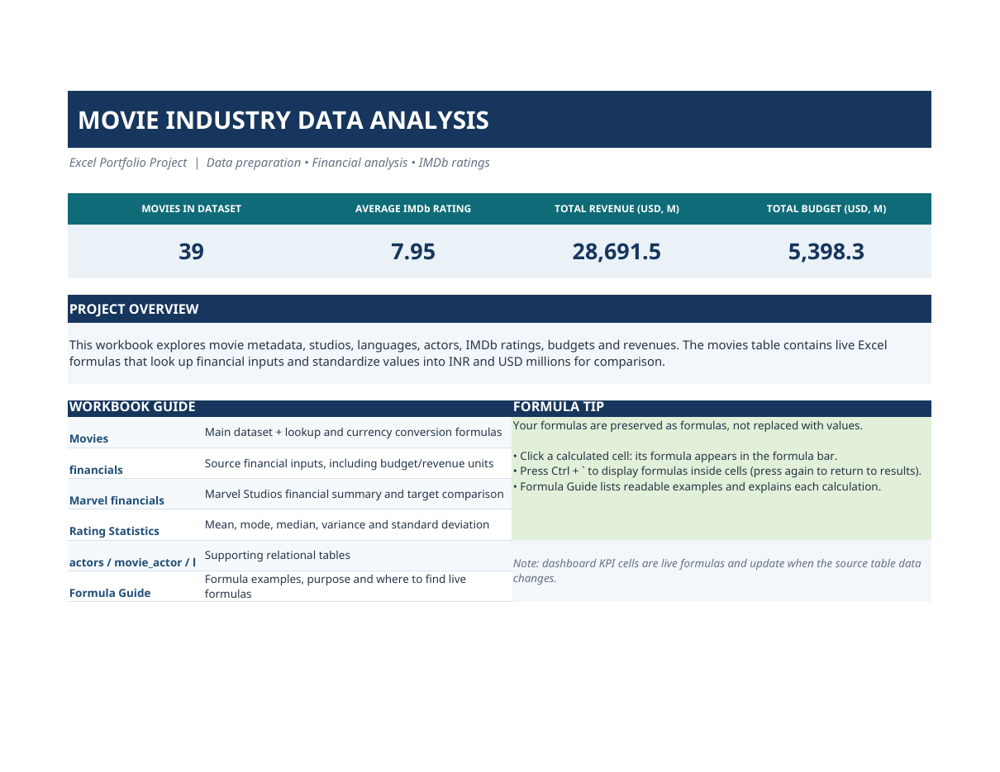
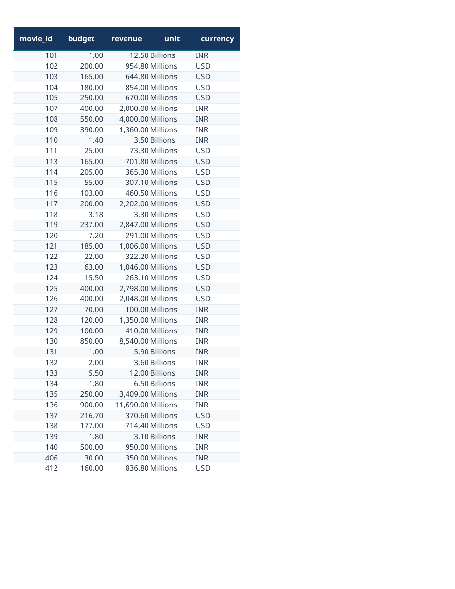
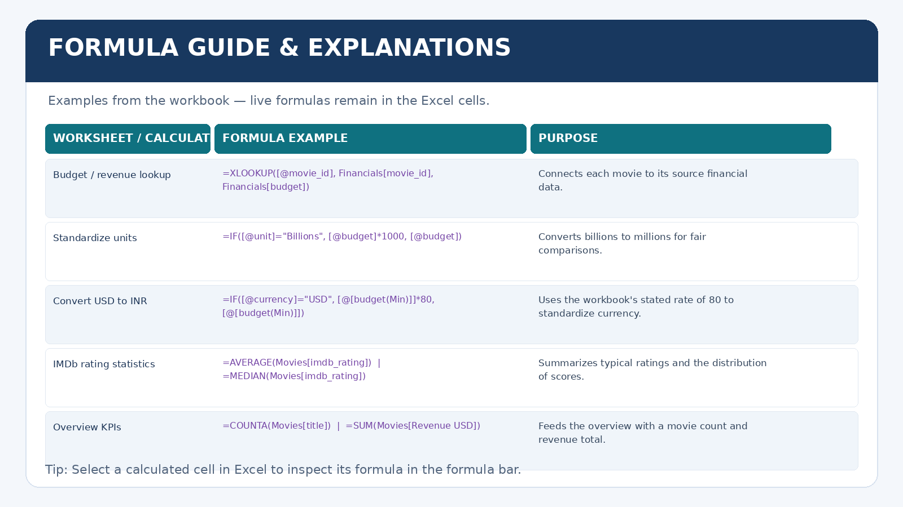

# 🎬 Movie Industry Data Analysis | Excel Portfolio Project

> An Excel-based data analysis project exploring movie metadata, IMDb ratings, studios, languages, actors, budgets, and revenues.



## 📌 Project Overview

This project uses Microsoft Excel to organize and analyse a movie-industry dataset. It combines movie details with financial inputs and supporting lookup tables, then presents summary metrics and formula examples in a structured workbook.

The workbook contains **39 movies** and includes an overview sheet, movie data, financial tables, rating statistics, supporting relational tables, and a formula guide.

## 🎯 Project Objectives

- Explore movie information such as release year, industry, studio, language, and IMDb rating.
- Connect movie records with financial inputs using lookup formulas.
- Standardize budget and revenue units for easier comparison.
- Convert USD values to INR using the workbook's stated conversion rate.
- Summarize IMDb ratings using statistical formulas.
- Present key metrics in a clear Excel overview sheet.
- Document formulas so another person can understand and verify the calculations.

## 🧰 Tools & Skills

- **Microsoft Excel**
- Excel formulas: `XLOOKUP`, `IF`, `COUNTA`, `SUM`, `AVERAGE`, `MODE`, `MEDIAN`, `VAR.P`, `STDEV.P`
- Data preparation and standardization
- Financial data analysis
- Descriptive statistics
- Lookup tables and relational data organization
- Spreadsheet formatting and reporting

## 📊 Workbook Preview

### 1. Overview

The Overview sheet highlights the main workbook metrics and explains how the other sheets are organized.


### 2. Financial Source Data

The financial source table stores movie IDs, budgets, revenue, units, and currencies. The movie table uses these inputs for lookups and standardized calculations.



### 3. Formula Guide

The Formula Guide explains what selected formulas do, why they are useful, and where to find the live formula cells in the workbook.



## 🗂️ Workbook Structure

| Sheet | Purpose |
|---|---|
| `Overview` | Key metrics and a guide to the workbook |
| `movies` | Main movie dataset and calculated financial fields |
| `financials` | Source budget/revenue values, units, and currencies |
| `Marvel financials` | Marvel financial summary and target comparison |
| `Rating Statistics` | Mean, mode, median, variance, and standard deviation of IMDb ratings |
| `actors` | Actor reference data |
| `movie_actor` | Movie-to-actor relationship data |
| `languages` | Language lookup data |
| `Formula Guide` | Formula examples, explanations, and cell locations |

## 🔍 Highlights

- **39 movies** included in the workbook.
- The Overview sheet reports an average IMDb rating of approximately **7.95**.
- The Overview sheet reports total revenue of approximately **28,691.5 USD million** and total budget of approximately **5,398.3 USD million**.
- Formula-driven fields connect movie and financial records.
- Unit conversion logic standardizes billion and million amounts.
- Rating statistics help describe the distribution of IMDb scores.

*These figures reflect the current workbook and may change if its source data or formulas are updated.*

## 🧮 Example Formula Logic

**1. Look up a movie's financial input**

```excel
=XLOOKUP([@movie_id],Financials[movie_id],Financials[budget],"Not Available",0)
```

Looks up a movie's budget by matching its `movie_id` to the financial source table.

**2. Convert billions to millions**

```excel
=IF([@unit]="Billions",[@budget]*1000,[@budget])
```

Standardizes amounts into millions so that values can be compared consistently.

**3. Convert USD to INR**

```excel
=IF([@currency]="USD",[@[budget(Min)]]*80,[@[budget(Min)]])
```

Uses the workbook's stated conversion rate of 80 to convert USD-denominated budget values to INR. This is a project assumption, not a live exchange rate.

**Note:** Formula examples are included for explanation. Open the Excel workbook to inspect the live formulas in their original cells.

## 🚀 How to Use This Project

1. Download `Movie_Industry_Data_Analysis.xlsx`.
2. Open it in Microsoft Excel or a compatible spreadsheet application.
3. Start with the `Overview` sheet.
4. Explore the `movies` and `financials` sheets to see the source data and calculations.
5. Open `Formula Guide` to understand the formula examples and locate live formula cells.

For best formula compatibility, use a recent version of Microsoft Excel that supports `XLOOKUP` and structured table references.

## 📁 Repository Contents

```text
movie-industry-data-analysis/
├── README.md
├── Movie_Industry_Data_Analysis.xlsx
└── screenshots/
    ├── overview.png
    ├── financial-source-table.png
    └── formula-guide-preview.png
```

## ⚠️ Notes & Limitations

- The USD-to-INR conversion rate of **80** is fixed in the workbook for demonstration and comparison.
- Financial values and movie information depend on the dataset included in the workbook.
- This project is for learning and portfolio demonstration; it should not be treated as verified financial reporting.
- Add the original dataset/tutorial source and any required attribution here before publishing, if applicable.

## 👨‍💻 Author

**Dev Pal**  
B.Tech Computer Science Engineering Student  
Interests: Data Analysis, SQL, Excel, and Business Intelligence

---

If you find this project useful, feel free to explore the workbook and review the formula guide.
